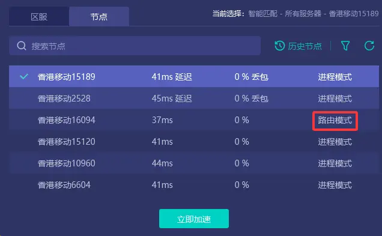

# L4D2 Mod 管理器

求生之路 2 的 Windows 本地模组管理器。一键整理，自动识别分类，一键启停；支持创意工坊链接、物品 ID 与本地压缩包导入模组。

## 系统要求

| 项   | 要求                                                                                                   |
| ---- | ------------------------------------------------------------------------------------------------------ |
| 系统 | Windows 10 1803 及以上 / Windows 11（需要系统自带的 **WebView2** 运行时，Win11 与新版 Win10 默认包含） |
| 游戏 | Left 4 Dead 2（需要能读到 `left4dead2/` 目录）                                                         |
| 网络 | 只有「创意工坊链接下载」需要；连不上 Steam 时其余功能照常可用                                          |
| 安装 | 免安装，解压即用                                                                                       |

WebView2 缺失时程序会直接启动失败，请先安装
[Microsoft Edge WebView2 Runtime](https://developer.microsoft.com/microsoft-edge/webview2/)。

---

## 核心机制

### 扫描与启停

管理器扫描 `left4dead2/addons/` 下的 `.vpk`，解析 VPK 内的 `addoninfo.txt` 得到标题与内容路径，
再据此推断分类（角色 / 特感 / 武器 / 地图 / 其他）。

启用状态写进游戏自带的 `left4dead2/addonlist.txt`：`"1"` 启用、`"0"` 禁用。管理器里的开关
与游戏内「附加内容」菜单启用状态一致。

<p align="center">
  
  <br>
  <sub>模组前面那个小标志就是启用状态(我打了Mod)</sub>
</p>

在游戏里手动开关模组后，回管理器点一次「刷新」（或按 <kbd>F5</kbd>）即可读到最新状态。
某个模组不在 `addonlist.txt` 里时，按游戏行为视为启用，并在下次写入时补记。

**单击卡片详情，双击切换启停**

### 分类与子分类

每个模组有两个层级：**分类**（角色 / 特感 / 武器 / 地图 / 其他）和**子分类**（具体物品，
比如 `Ellis`、`AK-47`、`具体的地图模组合集`）。

子分类由分类器根据 VPK 内容自动推断，也可以自定义：详情栏 →「更多」→ 点一下子分类，
在列表中选择即可更改，或在最上方一行直接输入新名字自定义新子分类。

**同组互斥** 角色、特感、枪械、近战、医疗品、投掷这六类外观模组，默认「同一个子分类只允许
启用一个模组」，功能可开关。

### 整理现有模组

Steam 创意工坊的订阅内容默认下载到 `left4dead2/addons/workshop/` 下面。模组多了会严重拖慢进游戏。
点左侧栏的「整理」会把它们搬出来：

- 把 `workshop/` 里的模组移到 `left4dead2/addons/` 顶层；
- 把子目录里的模组一并移到顶层；
- 登记所有还没入库的模组。

> 整理**会移动文件**，所以带确认框。只想重新读一遍磁盘状态，请用顶栏的「刷新」（或 <kbd>F5</kbd>），
> 它只读不写。

迁移完成后建议去 Steam 取消对这些物品的订阅，否则下次启动游戏又会把它们下回 `workshop/`。

### 压缩包导入

支持点击选择或直接拖入 ZIP、7z、RAR。正式版优先使用随软件附带的 7-Zip 命令行组件；
如果内置组件缺失，会继续找系统里已安装的 7-Zip / WinRAR 和 `PATH`。

`_dir.vpk + _NNN.vpk` 形式的多卷 VPK 会被识别成同一组，并通过内容指纹查重，避免重复入库。

导入的模组默认启用。但如果打开了「同组互斥」且这个物品已经有一个启用中的模组，则新导入的模组则会被禁用。一次导入多个同组的模组时，按名称取第一个启用。

### 创意工坊下载

打开模组的创意工坊页面，复制地址栏链接或使用模组ID粘进「链接下载」。

<p align="center">
  
  <br>
  <sub>在 Steam 创意工坊页面复制模组链接</sub>
</p>

合集链接也能解析，会展开成条目列表让你逐项勾选。下载前会比对本地模组库与工坊订阅，
已入库的自动跳过；下载时优先走 `file_url` 直连，失败后切换为 SteamCMD。

启用规则和压缩包导入一致：同组已有启用项时，新下载的只入库不启用；同组全空才自动启用。

#### 网络环境

工坊下载需要能连到 Steam 的网络。一般加速器只加速游戏进程，**不会**加速管理器本身。
请把加速器切到「路由模式」（而不是「进程模式」），或者用 Clash、V2Ray 等网络代理工具确保模组管理器能访问 到 Steam 网络。

<p align="center">
  
  <br>
  <sub>在加速器里切到「路由模式」</sub>
</p>

### 地图合集

工坊地图合集会被识别：已有部件自动归到同一合集下，缺的继续下载。合集在界面上是**纯展示分组**，
不参与任何启停逻辑。

---

## 下载与快速开始

最新正式版请到 [GitHub Releases](https://github.com/PolysaCHride/l4d2-mod-manager/releases/latest) 下载。

1. 下载 `L4D2 Mod Manager-v1.3-win64-web.zip` 并解压。
2. 运行 `L4D2 Mod Manager.exe`，无需安装。
3. 首次启动会引导你选游戏目录（一般能自动检测到），然后点「整理」把现有模组收进库里。
4. 之后按需导入压缩包或从创意工坊下载。

> **操作前请先退出游戏。** 游戏运行期间管理器会拒绝一切写操作。

---

## 从源码运行

需要 Python 3.14 和 Node.js 18+ 。

```powershell
python -m venv .venv
.\.venv\Scripts\pip install -r requirements.txt
.\.venv\Scripts\python main_web.py
```

`main.py` 是已归档的旧 PySide6 界面，仅供查阅，不再发版。

### 测试

```powershell
# 业务逻辑单测 + 前后端契约测试（93 个）
.\.venv\Scripts\python -X utf8 -m unittest discover -s tests

# 前端契约测试（55 项，只需要 Node）
node tests\adapt_contract.js

# 桥接层自测（不开窗口）
.\.venv\Scripts\python -X utf8 -m app.shell._selftest

# 发布前自检（版本号一致性 / 测试 / 文档资源 / 打包链路）
.\.venv\Scripts\python scripts\release_preflight.py --version 1.3.0
```

### 打包

```powershell
# 默认就是新界面，会自动带 7-Zip、跑冒烟测试、校验产物
.\build_release.ps1 -Version 1.3.0

# 无 GUI 环境（CI）关掉冒烟
.\build_release.ps1 -Version 1.3.0 -NoSmoke
```

产物在 `release/`。`third_party/7zip/` 是构建时下载并随包分发的，缺失会让构建**直接失败**
而不是产出一个跑不起来的包。

---

## 项目结构

```text
app/core/     # VPK 解析、分类、addonlist 读写、模组库、解压组件、导入与下载
app/shell/    # 桥接层：pywebview 的 js_api、长任务线程、事件推送
app/webui/    # 前端：index.html / app.js / app.css / tokens.css
app/ui/       # 已归档的旧 PySide6 界面，仅供查阅
assets/       # 应用图标与分类占位图
docs/         # 数据格式、旧界面去留、前端设计稿与验收探针
packaging/    # Windows 版本信息
third_party/  # 7-Zip 组件
```

## 许可证

项目代码采用 [MIT License](LICENSE) 开源。应用图标、资源分类数据与内置的 7-Zip 包含第三方内容，
来源与许可说明见 [THIRD_PARTY_NOTICES.md](THIRD_PARTY_NOTICES.md)。
