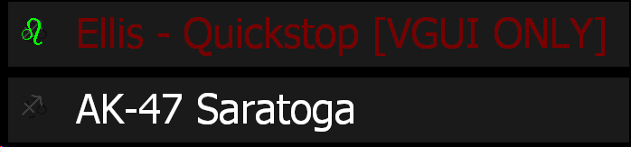
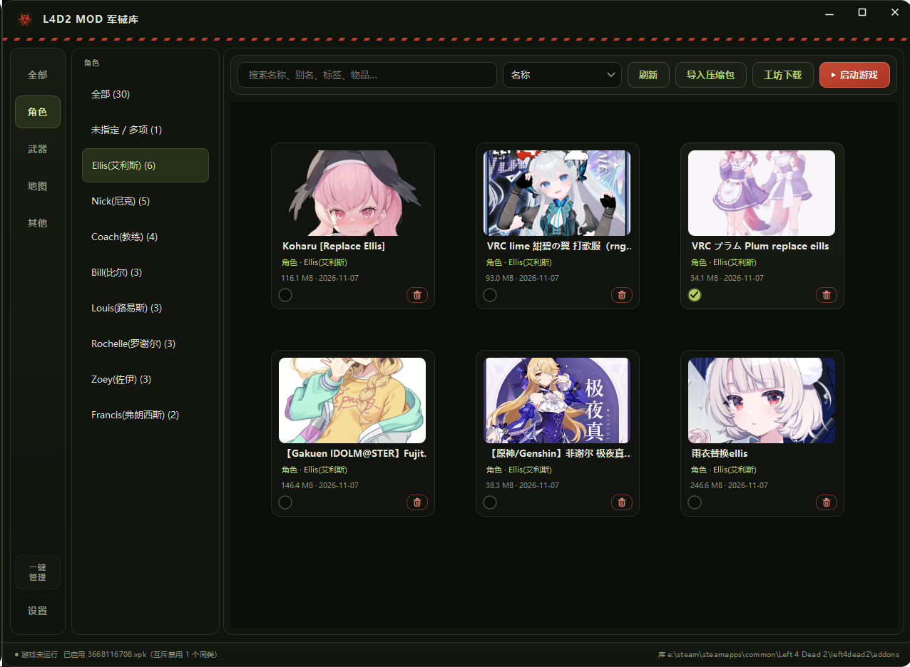
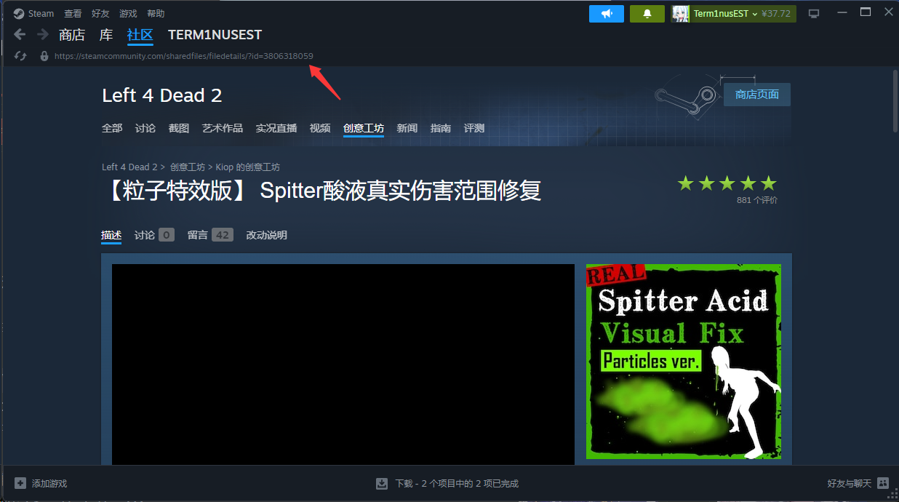
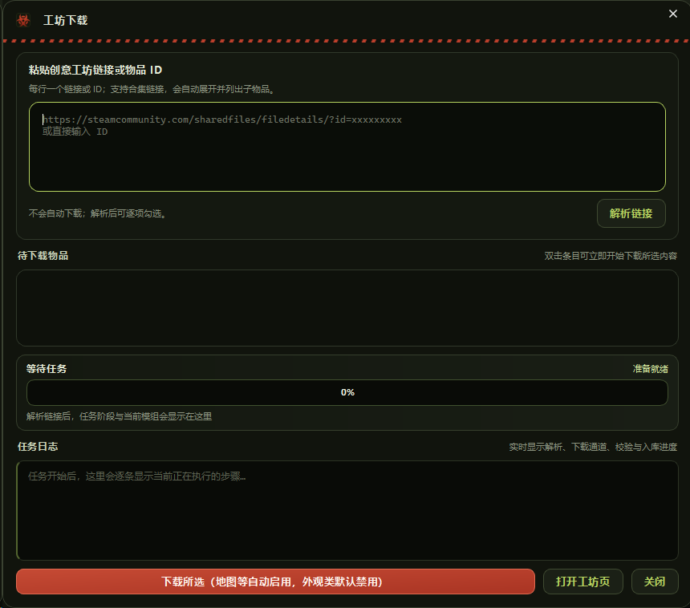

# L4D2 Mod 管理器

求生之路 2 的 Windows 本地模组管理器。支持快速切换武器皮肤、角色模型和地图，
可通过创意工坊链接、物品 ID 或本地压缩包导入模组，并支持自定义别名、分类与合集管理。

## 核心机制

### 一键管理现有模组

Steam 创意工坊模组默认存放在 `left4dead2/addons/workshop/`。游戏启动时会检查这些订阅内容，模组较多时会拖慢进入游戏的速度。

使用「一键管理」可以将现有模组整理到管理器中：

- 将 `workshop/` 中的模组移至 `left4dead2/addons/` 顶层。
- 自动登记尚未加入模组库的内容。
- 对角色、枪械等外观类冲突模组，默认每个具体物品只保留一个启用项；整理前已有明确选择时优先保留，否则启用按名称排序的第一项。

迁移完成后，建议在 Steam 中取消对应订阅，避免游戏再次将这些模组下载到 `addons/workshop/`。

### 启用与禁用

管理器通过游戏自带的 `left4dead2/addonlist.txt` 控制模组状态：`"1"` 表示启用，`"0"` 表示禁用。
因此，管理器中的开关与游戏内「附加内容」菜单的勾选状态保持一致。禁用模组只会取消勾选，不会让它从菜单中消失。

<p align="center">
  
</p>

在游戏内手动开关模组后，回到管理器刷新即可读取最新状态。如果某个模组未出现在 `addonlist.txt` 中，管理器会按照游戏行为将其视为启用，并在游戏关闭后补记。

### 同类外观一键切换

同一武器、角色或特感的外观模组默认互斥。例如，启用一个AK-47 mod时，其他AK-47 mod会自动禁用，不必再逐个寻找并关闭旧模组。

<p align="center">
  
</p>

未指定具体物品的多项内容、合集和整合包不参与这种互斥切换。

### 创意工坊下载

打开模组的Steam创意工坊页面，点击页面上方地址栏中的链接复制并粘贴到管理器中，即可解析并下载；也可以直接输入物品 ID。

<p align="center">
  
  &nbsp;&nbsp;
  
</p>

除了单个物品，管理器也支持创意工坊合集链接，可以自动展开合集并列出其中的模组，供你逐项选择下载。

下载前会检查本地模组库和工坊订阅中的重复内容，已入库的条目会自动跳过。下载优先使用 `file_url` 直连，失败后自动切换至 SteamCMD，并显示当前阶段、进度和实时日志。

非冲突类模组下载后自动启用，外观类模组默认禁用，避免多个模组同时覆盖同一物品。

### 压缩包导入

支持点击选择或直接拖入 ZIP、7z、RAR 压缩包。正式版会优先使用随软件附带的 7-Zip 命令行组件，如果内置组件缺失，管理器会继续查找系统中已安装的 7-Zip / WinRAR 和 PATH；仍不可用时，可以选择自动下载安装 7-Zip 官方发布的组件，或手动指定已有的 `7z.exe`。

对于 `_dir.vpk + _NNN.vpk` 形式的多卷 VPK，管理器会自动识别为同一组文件，并通过内容指纹检查重复模组，避免重复入库。

### 地图合集与文件安全

- 可识别工坊地图合集，将已有组件归入同一合集，并继续下载缺失组件。
- 游戏运行期间，会阻止可能修改模组状态的写入操作。
- 删除模组时，文件会被移至回收站。

## 下载与快速开始

最新正式版请前往 [GitHub Releases](https://github.com/PolysaCHride/l4d2-mod-manager/releases/latest) 下载。

1. 下载并解压 `L4D2 Mod Manager-v1.1-win64.zip`。
2. 运行 `L4D2 Mod Manager.exe`，无需安装。
3. 在「设置」中自动检测或手动选择 L4D2 安装目录。
4. 建议先使用「一键管理」整理现有模组，再按需导入或下载新模组。

> **注意：** 进行管理、导入或下载操作前，请先退出游戏，避免游戏占用文件或覆盖配置。

## 从源码运行

在项目根目录执行以下命令：

```powershell
python -m venv .venv
.\.venv\Scripts\pip install -r requirements.txt
.\.venv\Scripts\python main.py
```

构建 Windows 便携版前，需要在虚拟环境中安装 PyInstaller，然后运行：

```powershell
powershell -ExecutionPolicy Bypass -File .\build_release.ps1 -Version 1.1
```

构建产物位于 `release/`。

## 项目结构

```text
app/core/   # VPK 解析、分类、addonlist 读写、模组库、解压组件、导入与下载
app/ui/     # PySide6 界面
assets/     # 应用图标与分类图标
packaging/  # Windows 版本信息
third_party/7zip/ # 构建时下载并随发布包分发的 7-Zip 组件
```

## 许可证

项目代码采用 [MIT License](LICENSE) 开源。应用图标和资源分类数据包含第三方内容，具体来源与许可说明见 [THIRD_PARTY_NOTICES.md](THIRD_PARTY_NOTICES.md)。
