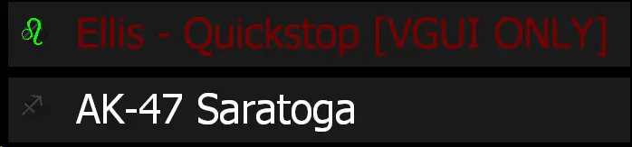
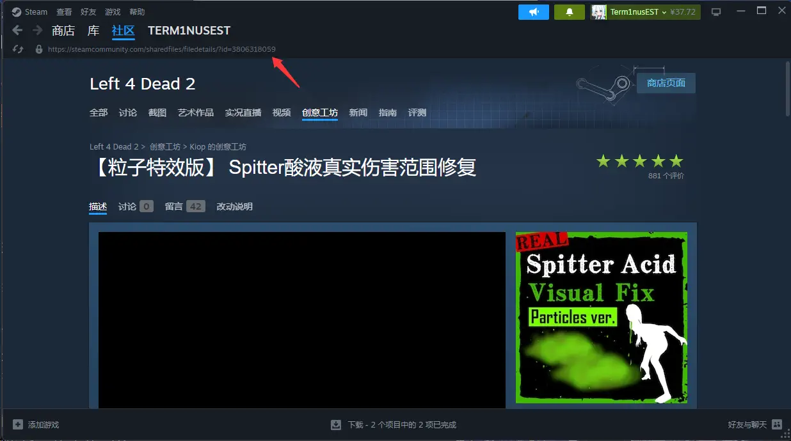
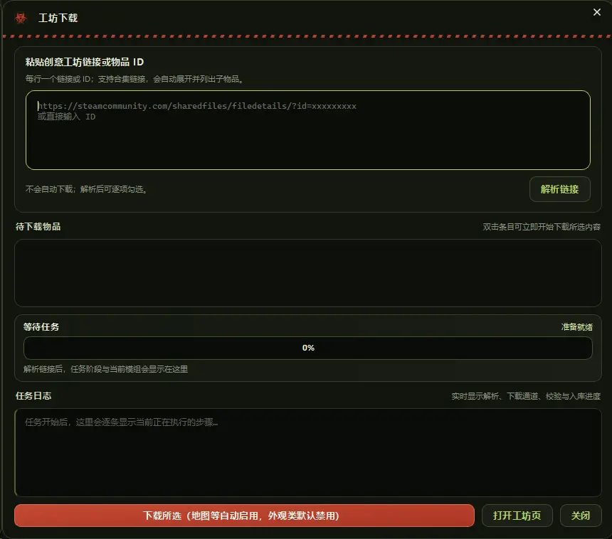

# L4D2 Mod 管理器

求生之路 2 的 Windows 本地模组管理器。扫描 `left4dead2/addons/` 下的 VPK，自动识别分类，
一键启停；支持创意工坊链接、物品 ID 与本地压缩包导入，并能把工坊订阅整理进模组库。

> **v1.3 起界面全部重写。** 旧的 PySide6 界面已归档（`archive/legacy-ui-2026-11-21`），
> 新界面用 pywebview + 系统 WebView2 渲染：解压后约 46 MB、压缩包 22 MB，
> 对比实测被否掉的 QtWebEngine 方案（454 MB）小一个数量级。

---

## 系统要求

| 项 | 要求 |
|---|---|
| 系统 | Windows 10 1803 及以上 / Windows 11（需要系统自带的 **WebView2** 运行时，Win11 与新版 Win10 默认包含） |
| 游戏 | Left 4 Dead 2（Steam 正版，需要能读到 `left4dead2/` 目录） |
| 网络 | 只有「创意工坊下载」需要；连不上 Steam 时其余功能照常可用 |
| 安装 | 免安装，解压即用 |

WebView2 缺失时程序会直接启动失败，请先安装
[Microsoft Edge WebView2 Runtime](https://developer.microsoft.com/microsoft-edge/webview2/)。

---

## 核心机制

### 扫描与启停

管理器扫描 `left4dead2/addons/` 下的 `.vpk`，解析 VPK 内的 `addoninfo.txt` 得到标题与内容路径，
再据此推断分类（角色 / 特感 / 武器 / 地图 / 其他）。

启用状态写进游戏自带的 `left4dead2/addonlist.txt`：`"1"` 启用、`"0"` 禁用。所以管理器里的开关
与游戏内「附加内容」菜单**始终一致**——禁用只是取消勾选，模组不会从菜单消失。

<p align="center">
  
  <br>
  <sub>游戏内「附加内容」菜单会同步显示管理器的启停状态</sub>
</p>

在游戏里手动开关模组后，回管理器点一次「刷新」（或按 <kbd>F5</kbd>）即可读到最新状态。
某个模组不在 `addonlist.txt` 里时，按游戏行为视为启用，并在下次写入时补记。

**单击卡片看详情，双击切换启停。**

### 分类与子分类

每个模组有两个层级：**分类**（角色 / 特感 / 武器 / 地图 / 其他）和**子分类**（具体物品，
比如 `Ellis`、`AK-47`、`The Bloody Moors`）。

子分类由分类器根据 VPK 内容自动推断，也可以自己改：详情栏 →「更多」→ 点一下子分类的值，
在列表里选一个，或者在最上面一行直接输入新名字。改过的模组会被标记为已固定，重新扫描不会再覆盖。
改错了可以点「恢复自动」，回到分类器的判断。

只有管理器**担保**的物品才会出现在列表里。如果你装的是自带自制武器的地图（比如某些整合包里的
乒乓球拍、洋葱），那些武器不会变成所有人可见的子分类，而是落在「近战 → 未指定」里，你可以自己改名归类。

**同组互斥可以关。** 角色、特感、枪械、近战、医疗品、投掷这六类外观模组，默认「同一物品只允许
启用一个」——启用一个新的会自动停用同组的旧模组，游戏里不会出现两个皮肤抢同一份资源。

不想要这层保护？点工具栏上的「同组互斥」关掉即可。关掉后游戏本身允许多个同槽位 VPK 同时启用
（实际生效的是加载顺序靠后的那个），需要哪个就留哪个，管理器不再替你决定。

第一次打开这个开关时，如果库里已经存在「同一物品开了好几个」的情况，会先弹一个窗口列出
每组将保留哪个、将停用哪些，你点「默认启用」才会真的改；点「关闭互斥」就什么都不动。

### 整理现有模组

Steam 创意工坊的订阅内容默认下载到 `left4dead2/addons/workshop/` 下面。模组多了会拖慢进游戏，
而且管理器扫不到子目录里的东西。

点左侧栏的「整理」会把它们搬出来：

- 把 `workshop/` 里的模组移到 `left4dead2/addons/` 顶层；
- 把散在子目录里的模组一并移到顶层；
- 登记所有还没入库的模组。

如果「同组互斥」开着，整理还会顺手把每组收敛到一个启用项 —— 保留你原本就启用着的那个
（一组里开了多个时，按名称取第一个）。

> 整理**会移动文件**，所以带确认框。只想重新读一遍磁盘状态，请用顶栏的「刷新」（或 <kbd>F5</kbd>），
> 它只读不写。

迁移完成后建议去 Steam 取消对这些物品的订阅，否则下次启动游戏又会把它们下回 `workshop/`。

### 压缩包导入

支持点击选择或直接拖入 ZIP、7z、RAR。正式版优先使用随软件附带的 7-Zip 命令行组件；
如果内置组件缺失，会继续找系统里已安装的 7-Zip / WinRAR 和 `PATH`。

`_dir.vpk + _NNN.vpk` 形式的多卷 VPK 会被识别成同一组，并通过内容指纹查重，避免重复入库。

导入的模组默认启用。但如果「同组互斥」开着、而这个物品已经有一个启用中的模组，新导入的只会
入库、不会顶掉你现在用的那个——想换就手动切过去。一次导入多个同组的包时，按名称取第一个启用。

### 创意工坊下载

打开模组的创意工坊页面，复制地址栏链接粘进「链接下载」，或者直接填物品 ID。

<p align="center">
  
  &nbsp;&nbsp;
  
  <br>
  <sub>复制工坊链接（左），粘进「链接下载」解析（右）</sub>
</p>

合集链接也能解析，会展开成条目列表让你逐项勾选。下载前会比对本地模组库与工坊订阅，
已入库的自动跳过；优先走 `file_url` 直连，失败后切 SteamCMD，全程显示阶段、进度与日志。

启用规则和压缩包导入一致：同组已有启用项时，新下载的只入库不启用；同组全空才自动启用。

#### 网络环境

工坊下载需要能连到 Steam 的网络。一般加速器只加速游戏进程，**不会**加速管理器本身。
请把加速器切到「路由模式」（而不是「进程模式」），或者用 Clash、V2Ray 之类工具确保能访问 Steam。

<p align="center">
  
  <br>
  <sub>在加速器里切到「路由模式」</sub>
</p>

### 地图合集

工坊地图合集会被识别：已有部件自动归到同一合集下，缺的继续下载。合集在界面上是**纯展示分组**，
不参与任何启停逻辑——你不会因为「合集里少一个部件」而被阻止启用。

### 数据安全

- **扫描是只读的**：`addonlist.txt` 不会被扫描覆盖，尊重你在游戏内或别处做过的改动。
- **游戏运行时禁止写入**：`addonlist.txt` 被游戏独占，运行中写入会失败甚至损坏，所以所有写操作
  都会先检查。检测不到游戏状态时同样会拦住写入（宁可挡住，也不冒险）。
- **删除进回收站**：删掉的模组文件移到 `data/trash/`，不是直接抹掉。
- **数据在本地**：模组库、设置、缩略图缓存全在程序目录的 `data/` 下，不上传任何地方。

---

## 下载与快速开始

最新正式版请到 [GitHub Releases](https://github.com/PolysaCHride/l4d2-mod-manager/releases/latest) 下载。

1. 下载 `L4D2 Mod Manager-v1.3-win64-web.zip` 并解压。
2. 运行 `L4D2 Mod Manager.exe`，无需安装。
3. 首次启动会引导你选游戏目录（一般能自动检测到），然后点「开始整理」把现有模组收进库里。
4. 之后按需导入压缩包或从创意工坊下载。

> **操作前请先退出游戏。** 游戏运行期间管理器会拒绝一切写操作。

---

## 从源码运行

需要 Python 3.14（开发时用 3.14.7）和 Node.js 18+（只跑前端契约测试时需要）。

```powershell
python -m venv .venv
.\.venv\Scripts\pip install -r requirements.txt
.\.venv\Scripts\python main_web.py
```

`main.py` 是已归档的旧 PySide6 界面，仅供查阅，不再发版。

### 测试

```powershell
# 业务逻辑单测 + 前后端契约测试（93 个）
.\.venv\Scripts\python -X utf8 -m unittest discover -s tests

# 前端契约测试（55 项，只需要 Node）
node tests\adapt_contract.js

# 桥接层自测（不开窗口）
.\.venv\Scripts\python -X utf8 -m app.shell._selftest

# 发布前自检（版本号一致性 / 测试 / 文档资源 / 打包链路）
.\.venv\Scripts\python scripts\release_preflight.py --version 1.3.0
```

### 打包

```powershell
# 默认就是新界面，会自动带 7-Zip、跑冒烟测试、校验产物
.\build_release.ps1 -Version 1.3.0

# 无 GUI 环境（CI）关掉冒烟
.\build_release.ps1 -Version 1.3.0 -NoSmoke
```

产物在 `release/`。`third_party/7zip/` 是构建时下载并随包分发的，缺失会让构建**直接失败**
而不是产出一个跑不起来的包。

---

## 项目结构

```text
app/core/     # VPK 解析、分类、addonlist 读写、模组库、解压组件、导入与下载（与 UI 完全解耦）
app/shell/    # 桥接层：pywebview 的 js_api、长任务线程、事件推送
app/webui/    # 前端：index.html / app.js / app.css / tokens.css
app/ui/       # 已归档的旧 PySide6 界面，仅供查阅
assets/       # 应用图标与分类占位图
docs/         # 数据格式、旧界面去留、前端设计稿与验收探针
packaging/    # Windows 版本信息
third_party/  # 7-Zip 组件（构建时获取）
```

`HANDOFF.md` 是工程交接文档，写了「什么能碰、什么碰了会炸、为什么当初这么做」。

---

## 已知限制

- **WebView2 是硬依赖**：老版本 Win10 没装的会启动失败，需要先装运行时。
- **拖拽导入只有一半**：拖文件进来会识别扩展名并询问，但 WebView2 拿不到真实路径，最终仍走「点击选择」对话框。
- **快捷键只有 3 个**：<kbd>F5</kbd> 刷新、<kbd>Ctrl</kbd>+<kbd>K</kbd> 聚焦搜索、<kbd>Esc</kbd> 关弹窗。
- **工坊搜索没移植**：新界面不支持按关键词搜工坊，只能贴链接或物品 ID。
- **首次升级会重扫全库**：v1.3 的分类器版本号变了，第一次启动会把所有 VPK 重新解析一遍，
  模组多的话要等几十秒到几分钟。之后恢复正常。

---

## 许可证

项目代码采用 [MIT License](LICENSE) 开源。应用图标、资源分类数据与内置的 7-Zip 包含第三方内容，
来源与许可说明见 [THIRD_PARTY_NOTICES.md](THIRD_PARTY_NOTICES.md)。
