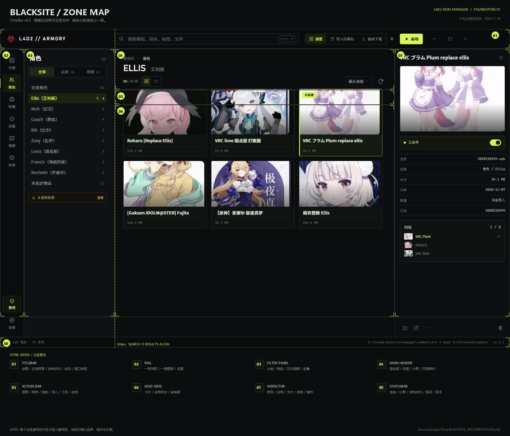

# BLACKSITE · 拆解底稿

> 状态：**对齐中，不是最终实现**。  
> 目标：先把 BLACKSITE 看得到的每一个分区、组件和文案拆开；你逐项确认后，才进入最终版布局。  
> 当前范围：主界面（模组浏览页）。设置页与弹窗属于后续独立分区，本文件只在边界处标注，不提前展开。

## 0. 已确定

- 布局：BLACKSITE（V1）。
- 主界面基准尺寸：1440 × 900；最小支持宽度 1100。
- 默认色板：BLACKSITE SIGNAL；SAFEHOUSE / WORKSHOP / INDEX 已沉淀为命名色板，见 [palettes.html](palettes.html) 与 [tokens.css](tokens.css)。
- 色板只是底层 token；本轮不实现主题切换 UI。
- 组件规则：只消费 token，不在组件里写死颜色。



## 1. 分区总览

| 编号 | 分区 | 宽度 / 高度 | 职责 | 主要交互 |
|---|---|---|---|---|
| 01 | TitleBar | 全宽 × 56 | 品牌、全局入口、窗口控制 | 拖动、最大化、搜索、窗口按钮 |
| 02 | Rail | 68 × 自适应 | 一级导航 | 切换大类、一键整理、设置 |
| 03 | FilterPanel | 256 × 自适应 | 分类 / 物品 / 状态筛选 | 过滤、查看冲突、容量提示 |
| 04 | MainHeader | 主区 × 116 | 当前上下文与页面动作 | 面包屑返回、整理、导入 |
| 05 | ActionBar | 主区 × 42 | 当前结果集的操作 | 视图、状态筛选、排序、刷新 |
| 06 | ModGrid | 主区 × 自适应 | 模组浏览 | 选中、启用、上下文菜单 |
| 07 | Inspector | 326 × 自适应 | 选中模组的详情与操作 | 启用、文件、同组、删除 |
| 08 | StatusBar | 全宽 × 30 | 全局状态 | 状态查看、路径入口 |

---

## 2. 逐区拆解

### 01 · TitleBar（已按 2026-11-18 需求更新）

> 状态：**已更新到预览图，待你确认样式后锁定。** 截图见 [preview.png](preview.png)，交互原型见 [preview.html](preview.html)。

**确认结果**

- 只保留：品牌 + 全局搜索 + 游戏状态 + 启动游戏 + 窗口按钮。
- 去掉：通知、标题栏设置、头像。
- 设置入口仍在 Rail；通知暂时没有入口，后续需要单独安排。
- 全局搜索左边界 = **324px**，严格对齐 04 / 05 / 06 主区左边界（Rail 68 + FilterPanel 256）。
- 启动游戏使用与全局一致的酸绿色 `--accent` 底色，深色字。
- 新应用图标已加入：来自 icon session 的最终红色点阵图标。
- 搜索宽度：`clamp(320px, 32vw, 480px)`；1440 下约 460px。

**结构**

```text
[新图标] L4D2 // ARMORY        [全局搜索 …… Ctrl K]          ● 游戏未运行   [启动游戏]   — □ ×
         LOCAL MOD COMMAND
         └──────── 324px ────────┘└──────────── 04/05/06 左边界 ────────────┘
```

**组件与文案**

| 组件 | 文案 / 内容 | 状态 | 备注 |
|---|---|---|---|
| App icon | 新图标 28×28 | 常态 | 点击无效，仅品牌 |
| Brand title | `L4D2 // ARMORY` | 常态 | 英文大写 + 斜杠分隔；中文标题待确认 |
| Brand subtitle | `LOCAL MOD COMMAND` | 常态 | 9px；窄窗可隐藏 |
| Global search | placeholder：`搜索模组、别名、标签、文件…` | 常态 / 聚焦 / 有结果 / 无结果 | `Ctrl K` 聚焦；`Esc` 清除焦点 |
| Game status | `游戏未运行` / `游戏运行中` / `未找到游戏目录` | 三种 | 运行中可能有写入锁定提示 |
| Launch game | `启动游戏` + play 图标 | 常态 / hover / 游戏中禁用 | 绿色底色；点击启动 L4D2 |
| Window controls | `最小化` / `最大化` / `关闭` | 常态 / hover / 最大化 | 关闭 hover 为红色；继续自绘窗口 |

**已确认**

- 品牌标题保留英文 `L4D2 // ARMORY`（2026-11-18）。
- 通知、标题栏设置、头像不再出现在 TitleBar。

**尚未确认**

1. 继续自绘窗口，还是改回 Windows 原生标题栏。
2. 1100 宽时搜索的最终收缩方式（当前 clamp + 隐藏副标题）。
3. 顶部已移除设置，Rail 的设置入口是否足够。

---

#### 01.1 通知模型（已确认 2026-11-18）

**结论：与旧版一致，使用阻塞弹窗；不新增通知中心。**

- TitleBar 不设铃铛，保持“品牌 + 搜索 + 状态 + 启动”。
- 不新增“待处理 N”入口，也不新增 toast 作为正式通知。
- 需要通知用户的结果，统一使用模态弹窗，确认或关闭后才能继续。
- 下载 / 导入 / 迁移的进度仍在各自对话框内展示；完成后弹结果窗。
- 弹窗本身作为独立组件族，按 BLACKSITE 重新设计，不在 TitleBar 阶段实现。

**需要弹窗的事件**

| 类型 | 事件 | 呈现 |
|---|---|---|
| 阻塞、需要行动 | 游戏运行中、不能写入 `addonlist` | 模态警告 + “知道了” |
| 阻塞、需要行动 | 游戏目录失效 / 解压组件缺失 | 模态提示 + 修复入口 |
| 长任务结束 | 工坊下载、压缩包导入、一键整理完成/失败 | 模态结果窗；失败可展开详情 |
| 需要决策 | 删除模组、清理缓存、合集归组 | 模态确认窗 |
| 信息 | 更新检查结果、自动检测结果 | 模态信息窗 |

**不弹窗的事件**

- 普通列表刷新。
- 单个模组启用 / 停用：卡片和 Inspector 内即时反馈。
- 每一条扫描日志：留在任务日志里。

**弹窗族清单（后续逐项重构）**

| 弹窗 | 作用 | 类型 |
|---|---|---|
| `AppMessageBox` | 信息 / 警告 / 确认 / 错误 | 基础弹窗 |
| `WorkshopDialog` | 工坊链接解析、选择、下载进度 | 复杂弹窗 |
| `ImportArchiveDialog` | 压缩包导入、拖放、结果 | 复杂弹窗 |
| `MissingArchiverDialog` | 7-Zip / WinRAR 缺失与安装 | 阻塞弹窗 |
| `MigrateDialog` | 迁移 workshop 条目 | 流程弹窗 |
| `CategoryDialog` | 分类管理 | 表单弹窗 |
| `DetailDialog` | 旧独立详情（可能被 Inspector 取代） | 待确认 |
| 退订提示 / 删除确认 | 迁移后提示、删除警告 | 确认弹窗 |

> 这一阶段只确认“用阻塞弹窗”这个行为模型；弹窗视觉、尺寸、按钮层级和具体文案留到 Gate 09 逐项对齐。

---

### 02 · Rail（已按 2026-11-18 需求更新）

**结构**

```text
[全部] [角色] [特感] [武器] [地图] [其他]
（空间）
[一键整理]
[设置]
```

**已确认**

| 组件 | 文案 | 图标语义 | 状态 |
|---|---|---|---|
| 全部 | `全部` | 四宫格 | 常态 / hover / 选中 |
| 角色 | `角色` | 双人 | 常态 / hover / 选中 |
| 特感 | `特感` | 感染者符号 | 常态 / hover / 选中 |
| 武器 | `武器` | 准星 | 常态 / hover / 选中 |
| 地图 | `地图` | 折叠地图 | 常态 / hover / 选中 |
| 其他 | `其他` | 立方体 | 常态 / hover / 选中 |
| 一键整理 | `一键整理` | 盾牌 | 常态 / hover / 忙碌 / 禁用 |
| 设置 | `设置` | 齿轮 | 常态 / hover / 选中 |

- **不增加**「下载」一级入口。
- **不增加**「合集」一级入口；合集只作为地图里的文件夹存在。
- 新增「特感」独立一级入口。
- 新增「其他」，收纳 UI / 音效音乐 / 载具 / 弹药 / 材质特效 / 动作 / 杂项 / 未分类。
- `一键管理` 更名为 `一键整理`。
- 图标下保留中文标签；宽度仍为 68px。
- 选中态保留左侧酸绿竖条 + 图标/文字变亮；是否作为唯一选中信号仍可继续讨论。

#### “合集”里到底放什么？

当前代码里的合集**不是按模组类型划分的分类**，而是一个「容器」：每个模组有 `collection` 字段，合集本身保存名称和 `files` 列表。

现在实际存在三类：

1. **工坊合集**
   - 来自 Steam 创意工坊合集链接。
   - 解析后展开子物品，可一次下载；已在库的部件会自动归组。
   - 子物品理论上可以是任何类别：地图、武器、角色、音效等。

2. **多部件地图合集**
   - 地图被拆成 `_dir.vpk + _001.vpk + _002.vpk …` 或工坊地图合集。
   - 这是当前最主要的合集使用场景。
   - 在「地图」分类的物品列表里以文件夹形式出现，可重命名、解散、删除整个合集。

3. **手动归入合集**
   - 当前只对「地图」模组开放右键入口：粘贴工坊合集链接，或选择已有合集。
   - 不支持把任意角色 / 武器模组拖进自定义合集。

**所以，如果新增一级「合集」，它会有三种可能定义：**

- **A. 地图合集**：只展示多部件地图和地图工坊合集。  
  风险：和「地图」下面的文件夹重复。
- **B. 工坊合集（全类别）**：展示所有导入过的工坊合集，包括武器、角色、音效合集。  
  代价：需要把当前只在地图分类下露出的合集逻辑扩展到全类别，并决定非地图合集怎么呈现。
- **C. 自定义合集**：用户把任意模组自由归组，类似播放列表 / 收藏夹。  
  代价：新增数据模型与批量操作，不只是导航改动。

**建议**

先不加「合集」一级入口。保持合集只作为「地图」里的文件夹存在；等确定它到底是 A / B / C 哪种产品概念，再决定是否升级为一级导航。否则它会同时和「地图」「收藏」「配装预设」三个概念重叠。

---

### 03 · FilterPanel（已定稿，进入预览）

完整拆解见 **[03-FILTERPANEL.md](03-FILTERPANEL.md)**。

**已确认**

- FilterPanel **不重复** Rail 中已有的分类，只显示当前 Rail 范围内的下一层。
- 「特感」已升为 Rail 一级入口，因此 FilterPanel 里有独立的「特感」面板。
- 「其他」已升为 Rail 一级入口，收纳 UI / 音效音乐 / 载具 / 弹药 / 材质特效 / 动作 / 杂项 / 未分类，使用可折叠缩进。
- 「武器」向下细分枪械 / 近战 / 医疗品 / 投掷，使用可折叠缩进。
- 状态筛选（全部 / 已启用 / 已停用）只保留在 FilterPanel；ActionBar 的 chips 已移除。
- FilterPanel 本地搜索已移除；全局搜索只在 TitleBar。
- 冲突降级为底部单行提示，仅存在时出现。
- 容量条移出 FilterPanel。

**面板对照**

| Rail | FilterPanel 标题 | 列表 |
|---|---|---|
| 全部 | 全部模组 (128) | 引导文案，不重复分类 |
| 角色 | 角色 (42) | 全部角色 / Ellis / Nick / … |
| 特感 | 特感 (16) | 全部特感 / Hunter / Smoker / … |
| 武器 | 武器 (67) | 折叠：枪械 / 近战 / 医疗品 / 投掷 |
| 地图 | 地图 (18) | 全部地图 / 合集文件夹 / 战役 |
| 其他 | 其他 (32) | 折叠：UI / 音效 / 载具 / 弹药 / 材质 / 动作 / 杂项 / 未分类 |

**布局验证**

| 宽度 | 搜索左边界 | 主区左边界 | 横向溢出 |
|---|---|---|---|
| 1440 | 324 | 324 | 0 |
| 1280 | 304 | 304 | 0 |
| 1100 | 304 | 304 | 0 |

**“冲突与容量”是什么**

两块都在 V1 样稿里被放进 FilterPanel，但都不属于筛选：

- **冲突**：提示“同物品外观组里旧模组仍启用”。但当前代码在启用/导入时已经自动处理同组互斥，所以它多数时候是伪问题；而且和 Inspector 的「同组模组」重复。现在降级为单行提示。
- **容量**：样稿的 `4.8 GB / 78.2 GB FREE` 是示意值——代码里没有汇总模组体积、也没有查询磁盘剩余空间的逻辑。要做成真实数据属于新功能，不是重构。现在移出 FilterPanel，留给 StatusBar / 设置页，是否实现待定。

---

### 04 · MainHeader（已按需求更新）

| 组件 | 文案 / 内容 | 状态 |
|---|---|---|
| 面包屑 | `模组库 › 角色 › Ellis` | **只读，不可点击** |
| 工作区切换 | `浏览` / `导入压缩包` / `链接下载` | 三个 tab |
| 主标题 | 当前物品（ELLIS / Nick / …） | 随选中项变化 |
| 说明 | `6 个外观模组 · 1 个已启用 · 同组自动互斥` | — |

原 `整理规则` 和 `导入模组` 两个按钮已移除：`整理规则` 在现有代码中没有对应功能，导入已改为独立工作区。

**需要确认**

- 有了面包屑之后，左侧 FilterPanel 是否仍显示同样的层级；如果重复，考虑去掉面包屑或去掉 FilterPanel 的“物品”层。
- `整理规则` 是否放在页头，还是收进 `一键整理` 或更多菜单。
- `导入模组` 是主操作，还是 `启动游戏` 才是？目前“启动游戏”在 TitleBar/StatusBar 的视觉权重还不够。
- 标题是否应显示当前物品（Ellis）还是当前页（模组库）。当前 V1 显示物品。

---

### 05 · ActionBar（已按需求更新）

| 组件 | 文案 / 内容 | 备注 |
|---|---|---|
| 结果计数 | `06 / 06 项` | 当前筛选结果 |
| 视图切换 | 网格 / 列表 | 两个图标按钮，有 tooltip |
| 排序 | `最近添加` | 下拉 |
| 刷新 | 图标按钮 | tooltip / aria：`刷新` |
| 批量操作 | 暂无 | 待确认是否需要多选 |

状态筛选已移到 FilterPanel，ActionBar 只剩四项。

**需要确认**

- 这个 ActionBar 是否还承担全局搜索？目前搜索在 TitleBar，两者职责如何区分。
- `全部 / 已启用 / 未启用` 与 FilterPanel 顶部的状态分段是否重复？如果是，二者只能保留一个。
- 是否需要“选择 / 批量启用 / 批量停用 / 批量删除”。
- 排序选项：`名称`、`最近添加`、`大小`、`启用优先` 是否全部保留。

---

### 06 · ModGrid

#### 6.1 ModCard

**结构**

```text
┌──────────────────────────────┐
│ [封面 16:9]  [已启用/未启用]  │
│                              │
├──────────────────────────────┤
│ 模组名称（1–2 行省略）        │
│ 角色 / Ellis                  │
│ 116.1 MB             2 天前   │
└──────────────────────────────┘
```

**卡片字段**

| 字段 | 示例 | 说明 |
|---|---|---|
| 封面 | 208×122 / 16:9 | 从 VPK 或缩略图提取；无图时用占位 |
| 状态标签 | `已启用` / `未启用` | 左上角，位于封面之上 |
| 名称 | `Koharu [Replace Ellis]` | 最多 1 行；列表视图可 2 行 |
| 分类 / 物品 | `角色 / Ellis` | 中间行 |
| 大小 | `116.1 MB` | 底部左 |
| 时间 | `2 天前` | 底部右 |
| 更多 | `…` | hover / focus 出现 |
| 选中态 | 左侧 2px 酸绿 + 深色底 | 与“已启用”区分：选中 ≠ 启用 |

**需要确认（关键）**

1. **点击卡片到底做什么？**
   - A（推荐）：点击卡片 = 选中并在 Inspector 显示；启用/停用由 Inspector 的开关完成。
   - B：点击卡片 = 直接切换启用（贴近当前版本行为，但误触风险高）。
   - C：单击选中，双击启用。
2. 卡片上是否直接放一个开关？
3. “已启用”是否用左上角标签 + 绿色边框 + Inspector 状态三处同时表达？
4. 同组互斥的影响是否要在卡片上提前显示（例如“将停用 2 个同组项”）？
5. 是否需要多选和批量操作；如果需要，卡片上如何呈现 checkbox。

#### 6.2 Grid summary / hint

| 区块 | 文案 |
|---|---|
| 来源健康 | `SOURCE HEALTH` / `128 已纳管` |
| 冲突监控 | `CONFLICT WATCH` / `1 个互斥组提醒` |
| 库容量 | `LIBRARY STORAGE` / `4.8 GB` / `可用 78.2 GB` |
| 键盘提示 | `点击卡片查看详情，Enter 启用当前模组，Space 快速切换` |

**需要确认**

- 这三个摘要条是常驻，还是只在滚动到底部时出现。
- 键盘提示是否保留；如果实现不完整，会变成错误承诺。
- 3 列卡片在 1440 下是否足够；1280 / 1100 如何降为 2 列。

---

### 07 · Inspector

| 区块 | 组件 | 文案 / 内容 |
|---|---|---|
| 顶部 | eyebrow | `SELECTED / 001` |
| 顶部 | 关闭 | `关闭详情` |
| 预览 | 图片 | 16:9 缩略图 |
| 预览 | 标签 | `VPK / THUMBNAIL` |
| 标题 | 名称 | `VRC プラム Plum replace ellis` |
| 标题 | 元信息 | `角色 / Ellis · 34.1 MB` |
| 状态 | 状态标题 | `已启用 · ACTIVE` |
| 状态 | 辅助 | `同组仅保留一个启用项` / `游戏内附加内容菜单已同步` |
| 状态 | 开关 | 启用 / 停用 |
| 规格 | 文件 | `3659210344.vpk` |
| 规格 | 入库时间 | `2026-11-07` |
| 规格 | 来源 | `本地导入` |
| 规格 | 冲突组 | `Ellis · 外观` |
| 同组 | 标题 | `同组模组` / `1 / 6 ACTIVE` |
| 同组 | 行 | `VRC Plum`（当前）、`Koharu`、`VRC lime` |
| 操作 | 主 | `在文件夹中显示` |
| 操作 | 危险 | `移入回收站` |

**需要确认**

- Inspector 是否常驻（1440）还是点击卡片后从右侧滑出（1100）。
- 详情信息是否足够；是否要加“别名 / 标签 / 备注 / 依赖”。
- 同组列表只显示 3 项，是否要“查看全部 6 项”。
- 删除是直接入回收站还是二次确认；当前样稿写的是回收站。
- 是否保留独立“详情弹窗”，还是 Inspector 取代它。

---

### 08 · StatusBar

| 组件 | 文案 | 备注 |
|---|---|---|
| 连接状态 | `LOCAL LIBRARY CONNECTED` | 失败时：`LIBRARY OFFLINE` / `未找到游戏目录` |
| 计数 | `128 MODS · 43 ENABLED` | 动态 |
| 游戏状态 | `GAME CLOSED` / `GAME RUNNING` | 与 TitleBar 重复，需确认是否保留一处 |
| 路径 | `E:\SteamLibrary\...\addons` | 过长省略；点击打开目录 |
| 版本 | `v1.2.1` | 只读 |

**需要确认**

- TitleBar 已有游戏状态，StatusBar 是否重复显示？建议 TitleBar 显示状态，StatusBar 只保留路径 / 版本。
- 路径过长如何截断；hover 是否显示完整 tooltip。
- 状态栏是否要显示扫描中 / 下载中 / 写入锁定等临时状态。

---

## 3. 跨组件规则（待确认）

### 3.1 信息优先级

1. 先看到“当前在看什么”（TitleBar / 面包屑 / 标题）。
2. 再看到“有哪些模组”（FilterPanel / Grid）。
3. 再看“选中项是什么、能不能启用”（Inspector）。
4. 最后才是全局状态（StatusBar）。

### 3.2 文案规则

- 中文主文案，英文只用于微标签 / 技术字段。
- 动作用动词：`导入模组`、`整理规则`、`在文件夹中显示`、`移入回收站`。
- 状态用短句：`已启用`、`未启用`、`游戏未运行`、`互斥组提醒`。
- 不用 emoji 作为结构图标；图标统一使用线性 SVG。
- 单位统一：`MB`、`GB`；数字与单位之间保留空格。
- 日期显示相对时间（`2 天前`），详情里显示绝对日期（`2026-11-07`）。

### 3.3 状态规则

| 状态 | 表现 |
|---|---|
| 常态 | 低对比边框，内容优先 |
| Hover | 边框提升 + 轻微背景变化，不位移布局 |
| Focus | 2px 可见焦点环，使用 `--focus-ring` |
| Selected | 左侧 2px 主色条 + 深色底；不等于启用 |
| Enabled | 主色标签 / 开关 / 状态点三选一或组合，需统一 |
| Disabled | 降低透明度，不响应点击，保留可读文本 |
| Busy | 局部进度 / spinner，不阻塞全局 |
| Error | 语义红 + 明确恢复路径 |

### 3.4 窗口与响应式

- 1440：4 区完整（Rail + FilterPanel + Main + Inspector）。
- 1280：FilterPanel 缩窄，卡片 2–3 列；Inspector 保持。
- 1100：Inspector 收起为抽屉；FilterPanel 可折叠；TitleBar 隐藏副标题。
- 最小 1100：不出现横向滚动；主区优先保留。

---

## 4. 待你拍板的产品问题

这些问题不解决，组件会反复返工：

1. **卡片点击语义**：选中 / 直接启用 / 双击启用。
2. **启用状态表达**：卡片标签、边框、开关，哪几个同时出现。
3. **FilterPanel 的层级**：分类 + 物品是否都常驻；面包屑是否重复。
4. **搜索的位置**：全局搜索在 TitleBar，ActionBar 是否还需要搜索。
5. **Inspector 的形态**：常驻 vs 抽屉；是否保留独立详情弹窗。
6. **游戏状态的位置**：TitleBar 或 StatusBar，只保留一处。
7. **配色使用方式**：四套色板只做 token 沉淀，还是开放为运行时主题。
8. **设置 / 下载 / 导入 / 迁移**：这些页面何时进入拆解。

---

## 5. 构建闸门

```text
Foundation (done)
  ↓
Gate 01  TitleBar          ← 当前
  ↓
Gate 02  Rail
  ↓
Gate 03  FilterPanel
  ↓
Gate 04  MainHeader + ActionBar
  ↓
Gate 05  ModCard + ModGrid
  ↓
Gate 06  Inspector
  ↓
Gate 07  StatusBar
  ↓
Gate 08  LibraryPage 组合
  ↓
Gate 09  设置 / 下载 / 导入 / 迁移 / 阻塞弹窗（全部重构）
  ↓
Gate 10  空态 / 加载 / 错误 / 键盘 / 响应式
```

每一关都按同一流程：

1. 对齐该组件的需求、文案、状态。
2. 做**独立组件预览**，不拼整页。
3. 你确认后，才加入最终版布局。
4. 记录变更，再进入下一件。

---

## 6. 第一关 · TitleBar 需求对齐

### 6.1 建议方案

- 高度 56px；继续自绘无边框窗口。
- 左侧品牌：`L4D2 // ARMORY` + `LOCAL MOD COMMAND`。
- 中部全局搜索：宽 370px，`Ctrl K`，`Esc` 清除焦点。
- 右侧：游戏状态、通知、设置、头像、窗口按钮。
- 1100 宽：搜索缩到 280px，隐藏副标题；窗口按钮不变。

### 6.2 三个选项

**A（推荐）· 完整控制台**

> 保留搜索、状态、通知、头像、自绘窗口按钮。最完整，也最符合 BLACKSITE。

- 优点：全局入口完整；后续通知/待处理有位置；品牌感强。
- 代价：右侧控件较多；1100 宽需要压缩搜索和副标题。

**B · 紧凑工具条**

> 保留品牌 + 搜索图标 + 状态 + 窗口按钮；搜索点击后展开浮层，去掉头像。

- 优点：更轻、更聚焦；小窗口更从容。
- 代价：搜索多一步；通知/账户弱化。

**C · 原生标题栏**

> 使用 Windows 原生标题栏，只保留品牌与菜单。

- 优点：实现风险最低；拖动/最大化行为最稳定。
- 代价：与 BLACKSITE 的自绘视觉割裂；很难统一主题。

### 6.3 本关需要回复

1. 选 **A / B / C**。
2. 标题文案保留英文 `L4D2 // ARMORY`，还是改成中文主标题？
3. 头像是否保留？
4. 顶部搜索是全局搜索吗？如果是，ActionBar 是否还需要搜索？

确认后，我只会做 `final/components/titlebar.html` 的独立预览，不会拼整页。
