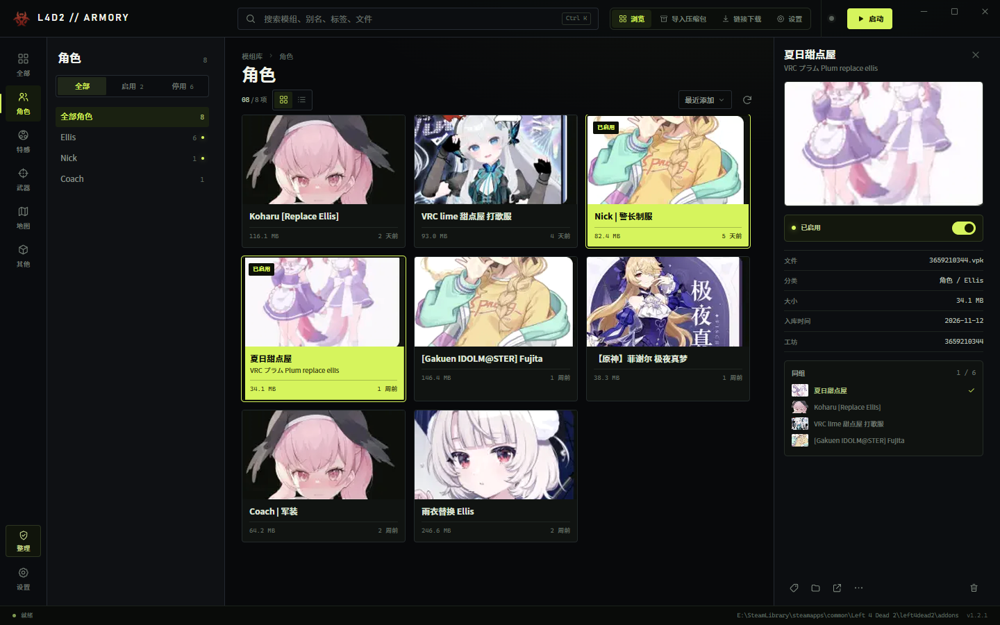

# 技术路线实测报告

> 三个方案都做了可运行原型并打包实测。**数字说话，不猜。**

---

## 一、结论

| 路线 | 承载层 | 打包体积 | 能否运行 | 判定 |
|---|---|---:|---|---|
| A | 纯 PySide6 原生 | **55 MB**（现有 v1.2.1） | ✅ | 可行，但前端要重写 |
| B-1 | PySide6 + QtWebEngine | **454 MB** | ✅ | ❌ 超 300MB 预算 |
| **B-2** | **pywebview + 系统 WebView2** | **28 MB** | ✅ | ✅ **推荐** |

**推荐 B-2**：体积 28MB，前端代码 100% 复用，业务逻辑零改动。

---

## 二、实测数据

### B-1：QtWebEngine

裁剪过程：删 debug 资源（-73MB）→ 只留中英语言包（-44MB）→ 最终 **454MB**。

| 构成 | 体积 |
|---|---:|
| `Qt6WebEngineCore.dll` | **195 MB** |
| `resources/` | 25 MB |
| `qml/` | 27 MB |
| `opengl32sw.dll` | 20 MB |
| `Qt6Core/Gui/Widgets/Quick/Qml` | 37 MB |
| Python + 其余 | ~25 MB |
| 其他杂项 | ~125 MB |

**195MB 的核心 DLL 不可压缩**，这是 Chromium 本体。即使删掉所有可裁资源，下限仍在 400MB 以上。

> 注：中途误把 `QtQml`/`QtQuick` 加入 `excludes`，导致 `ImportError: libshiboken`。WebEngine 依赖这两者，不能排除。这个坑记录在此，避免重犯。

### B-2：pywebview + WebView2

| 项 | 体积 |
|---|---:|
| Python 运行时 | ~15 MB |
| pywebview + pythonnet | ~7 MB |
| 前端资源（html/css/js/图标/缩略图） | ~1 MB |
| 业务逻辑（现有 app/core） | ~4 MB |
| **合计** | **28 MB** |

**系统 WebView2 Runtime 不占分发体积**（Win10/11 内置，388MB 装在系统里）。

### A：纯原生

现有 v1.2.1 已是 55MB，新增设计不改变技术栈，体积基本不变。

---

## 三、B-2 的完整验证记录

### 3.1 渲染保真度

WebEngine 与 Chrome 渲染结果**逐像素一致**：字体、荧光绿卡片、圆角、渐变、SVG 图标全部正确。



### 3.2 双向通信

QWebChannel 实测（`bridge_test.html`）：

```
✓ ping -> pong (1.7ms)
✓ getMods -> 3 条，首条「Koharu [Replace Ellis]」
✓ toggleMod -> enabled false → true
✓ setAlias -> 「测试别名」
```

pywebview 实测（`proto_pywebview.py --check`）：

```json
{"ping":"pong","modCount":2,"firstName":"Koharu [Replace Ellis]",
 "toggled":{"ok":true,"enabled":true},"cards":8,
 "brand":"L4D2 // ARMORY","accent":"#d6f45d","onCards":2}
```

8 张卡片渲染成功，中文无乱码，CSS 变量正确解析。

### 3.3 无边框窗口

`FramelessWindowHint` + `WA_TranslucentBackground` + `setBackgroundColor(Qt.transparent)` 组合正常工作，圆角与透明背景无异常。


---

## 四、为什么推荐 pywebview 而不是 QtWebEngine

两者底层都是 Chromium，渲染结果一样。差别在**打包方式**：

| | QtWebEngine | pywebview |
|---|---|---|
| Chromium 来源 | 打进包里 | 用系统的 WebView2 |
| 分发体积 | 454 MB | 28 MB |
| 首次启动 | 需解压 195MB DLL | 系统组件已就绪 |
| 用户机器要求 | 无 | 需 WebView2（Win10/11 自带） |
| API 风格 | Qt signal/slot | 简单 Python 方法 |

**唯一代价**：依赖系统 WebView2。缓解方案是启动时检测，缺失则弹窗给微软官方下载链接。

---

## 五、需要你知道的风险

### 5.1 WebView2 缺失

Win10 1803 之前、部分精简系统、部分企业环境可能没有。

- 检测：`webview.start()` 失败时捕获异常
- 处理：弹窗说明 + 打开微软下载页
- 概率：极低（Win11 100% 自带，Win10 已通过 Windows Update 普及）

### 5.2 pywebview 的窗口能力

比 Qt 弱：自定义拖拽区、多显示器 DPI、窗口吸附需要自己处理。已实测无边框可行，但**DPI 缩放需要单独测**（125%/150% 缩放）。

### 5.3 双栈调试

问题可能出在 Python、JS 或两者之间。缓解：统一日志前缀 `[PY]` / `[JS]`，pywebview 的 `debug=True` 会打开 DevTools。

### 5.4 中文输入法

pywebview 用 WinForms 宿主，输入法走系统。**未实测**，属于阶段 0 必须验证项。

---

## 六、前端代码复用度

这轮做的所有产物在 B-2 下**几乎零改动**：

| 产物 | 在 B-2 中的角色 |
|---|---|
| `demo.html/css/js` | 产品代码，直接部署 |
| `tokens.css` | 产品代码 |
| `states.html` | 弹窗组件蓝本 |
| `enabled-cards.html` | 已定稿，样式已进 demo.css |

**唯一要改的是数据来源**：现在 `demo.js` 用内存数组，要改成 `await pywebview.api.get_mods()`。

---

## 七、下一步

阶段 0 已完成（B-2 验证通过）。可以进入阶段 1：数据桥接。

待你确认后启动智能体团队，按 `REQUIREMENTS_LOCK.md` 的任务拆分执行。

**阶段 0 的实际产出**：

```text
docs/redesign/proto/
  proto_webengine.py    QtWebEngine 原型（备用）
  proto_pywebview.py    pywebview 原型（推荐方案）
  proto_frameless.py    无边框验证
  bridge_test.html      通信验证页
  proto.spec            WebEngine 打包配置
  pywebview.spec        pywebview 打包配置
  webengine.png         渲染验证
  frameless.png         无边框验证
  bridge.png            通信验证
```
